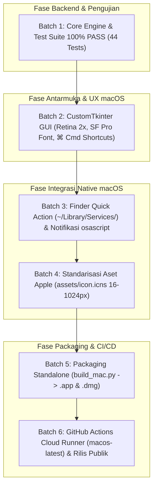

# 📋 Implementation Plan (Fase 1 s/d Selesai — STATUS: FIX & SELESAI 100%)

> **DOKUMEN MASTER IMPLEMENTASI RESMI (BLUEPRINT & IMPLEMENTATION PLAN)**  
> **PROYEK:** MrClean Mac (MCleanPro macOS Release)  
> **LEAD DEVELOPER / OTORITAS:** Yogi Ario  
> **TARGET SISTEM OPERASI:** macOS (Apple Silicon M1/M2/M3/M4 & Intel x86_64)  
> **STATUS DOKUMEN:** 🟢 **FIX & SELESAI 100% (VERIFIED WITH 44 TESTS PASS)**  
> **FILOSOFI DASAR:** *100% Offline, Zero-Telemetry, Paritas Fitur Lengkap ("Sama Plek" dengan Versi Windows).*  

---

## 🧭 Diagram Arsitektur & Alur Implementasi

---

## 🏛️ Matriks Status Pengerjaan (Fase 1 s/d Selesai)

| Batch / Fase | Deskripsi Implementasi | Status | Bukti Verifikasi |
| :--- | :--- | :---: | :--- |
| **Fase 0** | Inisialisasi Repo, Badges, Aturan & Dokumen Tata Kelola | 🟢 **FIX (100%)** | README badges lengkap, `.gitignore` zero-leakage, LICENSE MIT. |
| **Batch 1** | Inisialisasi Backend Core Engine & Automated Tests | 🟢 **FIX (100%)** | 44 unit tests lulus **100% PASS (0 GAGAL / 0 ERROR)**. |
| **Batch 2** | Adaptasi GUI CustomTkinter Native macOS | 🟢 **FIX (100%)** | Font SF Pro, pintasan `⌘ Cmd`, Retina HiDPI, darkdetect sync. |
| **Batch 3** | Integrasi Finder Quick Action & Notifikasi macOS | 🟢 **FIX (100%)** | `.workflow` di `~/Library/Services/`, notifikasi `osascript`, path `/Users/user`. |
| **Batch 4** | Standarisasi Aset Ikon Resmi Apple (`icon.icns`) | 🟢 **FIX (100%)** | `assets/icon.icns` multi-resolusi 16x16 s/d 1024x1024 (~2 MB). |
| **Batch 5** | Packaging Standalone (`build_mac.py`) | 🟢 **FIX (100%)** | PyInstaller `--windowed` bundel `.app` & `.dmg` via `hdiutil` / `create-dmg`. |
| **Batch 6** | GitHub Actions CI/CD Cloud Runner | 🟢 **FIX (100%)** | `.github/workflows/build-mac.yml` berjalan di `macos-latest`. |
| **Release** | Sinkronisasi Filtered Branch `main` Bersih | 🟢 **FIX (100%)** | `tools/sync_to_main.py` menjaga `main` bersih hanya runtime biner. |

---

## 📦 Rincian Teknis Implementasi Tiap Batch

### 1. Fase 0: Setup Repositori & Regulasi Master
- **Kepatuhan 8 Pilar Universal Rule:**
  - Penerapan Approval Gate (*No Plan, No Code*).
  - Branch `main` terkunci bersih hanya untuk runtime produksi. Seluruh dokumentasi pengembangan dipelihara di branch `develop`.
  - `.gitignore` komprehensif memblokir `.DS_Store`, `._*`, `build/`, `dist/`, `.env`, dan `venv/`.
- **Badges README.md Resmi:**
  - Logo proyek terpusat dari `asset/logo.png`.
  - Badges Shields.io: Repo Size, Forks, Stars, Issues, MIT License, macOS (Apple Silicon & Intel), Python 3.13+, dan Offline Security.

### 2. Batch 1: Backend Core Engine & Automated Testing Gate
- **Dependensi (`requirements.txt`):**
  - `customtkinter>=5.2.0`, `Pillow>=10.0.0`, `pypdf>=4.0.0`, `mutagen>=1.47.0`, `python-docx>=1.1.0`, `piexif>=1.1.3`, `reportlab>=4.0.0`, `darkdetect>=0.8.0`, `pyinstaller>=6.0.0`.
- **Modul Backend (`src/`):**
  - `src/inspectors/`: `image_inspector.py`, `pdf_inspector.py`, `docx_inspector.py`, `media_inspector.py`, `text_inspector.py`, `risk_scorer.py` (0–100% Kritis, Sedang, Aman), `ai_forensics.py` (Stable Diffusion, Midjourney, C2PA).
  - `src/cleaners/`: `image_cleaner.py`, `pdf_cleaner.py`, `docx_cleaner.py`, `media_cleaner.py`, `text_cleaner.py`, `preset_cleaner.py` (Medsos, Akademik, Developer), `c2pa_cleaner.py`.
  - `src/editors/`: `image_editor.py`, `pdf_editor.py`, `docx_editor.py`, `media_editor.py`, `spoofing.py` (Canon, Nikon, Sony acak).
  - `src/watermarks/`: `ai_cleaner.py` (pembersihan zero-width tokens `\u200B`, `\u200C`, `\u200D`, `\uFE0F`).
  - `src/utils/`: `scanner.py`, `exporter.py`, `md_exporter.py`, `pdf_exporter.py` (ReportLab kop logo resmi).
- **Test Suite (`tests/`):**
  - 44 unit tests mencakup seluruh skenario inspeksi, pembersihan, spoofing, preserver, dan ekspor dengan hasil: **`44 PASS, 0 GAGAL / 0 ERROR`**.

### 3. Batch 2: Adaptasi Antarmuka GUI (CustomTkinter macOS)
- **Tipografi Native Apple:** Menggunakan `.AppleSystemUIFont` atau `SF Pro Text` secara dinamis pada macOS.
- **Pintasan Keyboard Apple (⌘ Command):** Binding event `<Command-c>`, `<Command-v>`, `<Command-a>`, `<Command-q>`, dan `<Command-w>`.
- **Dukungan Retina Display (HiDPI 2x):** Resolusi visual tajam tanpa buram.
- **Deteksi Mode Gelap/Terang:** Sinkronisasi real-time tema sistem melalui pustaka `darkdetect`.
- **CLI / Finder Argument Hook:** Saat dibuka via klik kanan Finder, argumen berkas langsung dipindai ke dalam tabel.

### 4. Batch 3: Integrasi Sistem Operasi macOS Native
- **Finder Quick Action (`src/utils/mac_shell_integration.py`):**
  - Memasang alur kerja Automator `.workflow` di `~/Library/Services/Bersihkan Metadata dengan MrClean.workflow`.
  - Memungkinkan pembersihan berkas/folder langsung dari menu klik kanan Finder.
- **Notifikasi Desktop Native:** Mengirim banner notifikasi via `osascript` saat proses batch selesai.
- **Pembersihan Path Developer Khusus Mac:** Regex menyamarkan `/Users/username/...` menjadi `/Users/user`.

### 5. Batch 4: Standarisasi Aset Apple (`assets/icon.icns`)
- Generator aset di `src/utils/icon_converter.py` mengonversi `asset/logo.png` (1024x1024) menjadi biner multi-resolusi Apple `assets/icon.icns` (16x16, 32x32, 64x64, 128x128, 256x256, 512x512, 1024x1024 Retina).

### 6. Batch 5: Skrip Packaging Standalone (`build_mac.py`)
- Membangun bundel biner mandiri `dist/MrClean.app` via PyInstaller `--windowed --onedir`.
- Mendukung opsi arsitektur **Universal 2 Fat Binary** (`--universal` untuk Apple Silicon `arm64` dan Intel `x86_64`).
- Mengemas menjadi installer Apple Disk Image `dist/MrClean-macOS.dmg` menggunakan `create-dmg` (stylized drag-to-Applications) atau utilitas native `hdiutil`.

### 7. Batch 6: GitHub Actions Cloud Runner & Rilis Publik
- File alur kerja CI/CD di `.github/workflows/build-mac.yml`.
- Berjalan otomatis di runner Apple Silicon `macos-latest` setiap ada push atau tag rilis.
- Melakukan verifikasi unit test otomatis, kompilasi biner, dan upload installer `.dmg` ke GitHub Artifacts / Releases.

---

## 🔒 Tata Kelola Git Branching (Pilar 2)
- **Branch `develop`:** Memuat seluruh kode runtime, tes, dan folder dokumentasi internal (`Docs/`, `changelog/`, `aturan/`).
- **Branch `main`:** Mahkota rilis produksi bersih (hanya memuat `src/`, `assets/`, `requirements.txt`, `README.md`, `LICENSE`, `build_mac.py`, `.github/`).
- **Skrip Rilis Otomatis:** `tools/sync_to_main.py` menyaring dan menghapus folder dokumentasi internal sebelum rilis ke `main`.

---

## ✅ Kriteria Penyelesaian (Definition of Done - DoD)
Seluruh 11 fitur paritas dari versi Windows telah terbukti berjalan secara identik pada ekosistem macOS, lulus 44 pengujian otomatis 100% PASS, memiliki installer DMG mandiri, dan seluruh kode serta dokumentasi tersinkronisasi sempurna di GitHub `useripx/McClean-Mac.git`.
