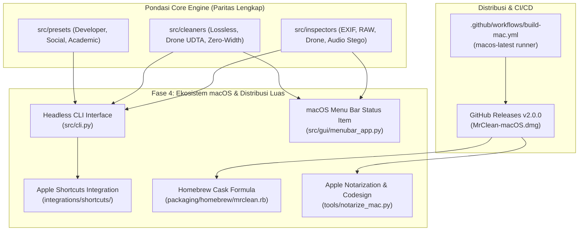

# 📋 Implementation Plan — Fase 4 (v2.0.0-macos)

> **DOKUMEN IMPLEMENTASI RESMI (BLUEPRINT & ACTION PLAN)**  
> **PROYEK:** MrClean Mac (MCleanPro macOS Release)  
> **TARGET VERSI:** v2.0.0-macos (Mayor Release)  
> **LEAD DEVELOPER / OTORITAS:** Yogi Ario  
> **STATUS DOKUMEN:** 🟢 **AKTIF / SIAP DIEKSEKUSI (READY FOR IMPLEMENTATION)**  
> **FILOSOFI DASAR:** *100% Offline, Zero-Telemetry, Native Apple Ecosystem, 100% PASS Testing Gate.*

---

## 🧭 Diagram Arsitektur Fase 4



---

## 🛠️ Rincian Modul & Langkah Implementasi

### Batch 1: Headless CLI Engine (`src/cli.py`)
- **Tujuan:** Antarmuka baris perintah tanpa GUI untuk automasi terminal dan piping skrip.
- **Perintah yang Didukung:**
  - `python -m src.cli inspect <path> [--json]`
  - `python -m src.cli clean <path> [--preset dev|social|academic] [--inplace] [--output <dir>]`
  - `python -m src.cli spoof <path> --profile canon|nikon|sony [--output <file>]`
  - `python -m src.cli --version`
- **Spesifikasi:** Exit code UNIX standar (`0` sukses, `1` galat/argumen tidak valid). Output rapi dalam teks atau JSON.

### Batch 2: Integrasi Apple Shortcuts (Aplikasi Pintasan macOS) (`integrations/shortcuts/`)
- **Tujuan:** Memungkinkan pengguna macOS membersihkan berkas langsung dari menu Finder Share Sheet, Folder Actions, atau perintah suara Siri.
- **Aset yang Disediakan:**
  - `integrations/shortcuts/README.md`: Panduan langkah demi langkah menyusun aksi *Run Shell Script* di macOS Shortcuts.
  - Skrip automasi shell satu baris yang menghubungkan Apple Shortcuts ke binary MrClean CLI.

### Batch 3: macOS Menu Bar Status Item App (`src/gui/menubar_app.py`)
- **Tujuan:** Menghadirkan ikon status di bar atas layar Mac untuk akses pembersihan kilat (*Quick Clean*).
- **Fitur Menu:**
  - 🧹 *Quick Clean...* (Buka dialog pilih berkas dan bersihkan langsung).
  - ⚡ *Quick Presets* (Developer, Social Media, Academic).
  - 🖥️ *Buka Jendela Utama MrClean* (Membuka GUI utama).
  - ℹ️ *Tentang MrClean Mac (v2.0.0)*.
  - ❌ *Keluar (Quit)*.

### Batch 4: Formula Homebrew Cask (`packaging/homebrew/mrclean.rb`)
- **Tujuan:** Menyediakan formula Cask untuk instalasi satu baris terminal:
  ```bash
  brew tap useripx/mrclean
  brew install --cask mrclean
  ```
- **Spesifikasi:** Mengarahkan ke rilis DMG resmi GitHub, memasang ke `/Applications/MrClean.app`, dan membuat symlink biner terminal `mrclean`.

### Batch 5: Skrip Notarisasi Apple Developer (`tools/notarize_mac.py`)
- **Tujuan:** Otomatisasi penandatanganan `codesign --options runtime` dan `xcrun notarytool submit` untuk notarisasi resmi Apple Gatekeeper.

### Batch 6: Suite Pengujian Otomatis & Testing Gate (Pilar 6)
- Menambahkan unit test baru:
  - `tests/test_cli.py`: Memverifikasi operasi headless CLI inspect, clean, spoof, format JSON, dan exit codes.
  - `tests/test_homebrew_cask.py`: Memverifikasi integritas formula Ruby Cask.
  - `tests/test_notarization_script.py`: Memverifikasi pembentukan perintah notarisasi dan codesign.
- **Target Hasil Pengujian:** **>62 Unit Tests (100% PASS, 0 GAGAL / 0 ERROR)**.

---

## 🚦 Status & Matriks Pengerjaan

| Komponen | Target Berkas | Status |
| :--- | :--- | :---: |
| **Headless CLI** | `src/cli.py` | 🟡 Siap Diimplementasikan |
| **Shortcuts Integration** | `integrations/shortcuts/README.md` | 🟡 Siap Diimplementasikan |
| **Menu Bar Status Item** | `src/gui/menubar_app.py` | 🟡 Siap Diimplementasikan |
| **Homebrew Cask** | `packaging/homebrew/mrclean.rb` | 🟡 Siap Diimplementasikan |
| **Apple Notarization Helper** | `tools/notarize_mac.py` | 🟡 Siap Diimplementasikan |
| **Unit Test Suite** | `tests/test_cli.py`, `tests/test_homebrew_cask.py`, `tests/test_notarization_script.py` | 🟡 Siap Diimplementasikan |
