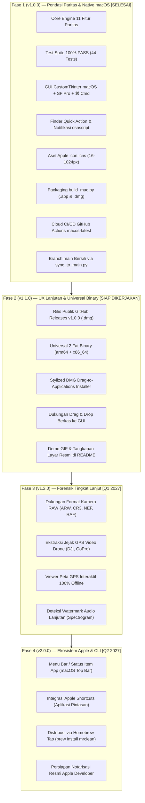

# 🗺️ Roadmap & Milestones — MrClean Mac (MCleanPro)

> **DOKUMEN PANDUAN PETA JALAN PRODUK (PRODUCT ROADMAP)**  
> **PROYEK:** MrClean Mac — Offline Metadata Inspector, Cleaner, Presets & AI Watermarks Remover  
> **OTORITAS / LEAD:** Yogi Ario  
> **STATUS:** AKTIF (TERAKHIR DIPERBARUI: 10 NOVEMBER 2026)  
> **FILOSOFI:** *100% Offline, Zero-Telemetry, Paritas Fitur Lengkap, Native Apple Human Interface Guidelines.*  

---

## 🧭 Peta Jalan Visual (Architecture & Release Timeline)



---

## 📍 Rincian Fase & Milestone Proyek

### 🟢 FASE 1: Pondasi Paritas Penuh & Adaptasi Native macOS (v1.0.0-macos)
**Target: 10 November 2026 | Status: SELESAI 100% (COMPLETED)**

- [x] **Tata Kelola 8 Pilar Universal:**
  - Penerapan Master Framework macOS, Approval Gate, Clean `main`, Zero Leakage `.gitignore`, dan Documentation-First.
- [x] **Backend Agnostic (Paritas 11 Fitur Lengkap):**
  - Inspeksi mendalam EXIF, GPS, Serial Perangkat, Author, dan Riwayat Software pada Gambar, PDF, DOCX, Media, dan Teks.
  - Pembersihan Lossless (tanpa kompresi piksel/kerusakan format).
  - Penghapusan AI Steganography & Zero-Width Spaces (`\u200B`, `\u200C`, `\u200D`, `\uFE0F`).
  - Privacy Risk Scorer (0–100% dengan status Kritis, Sedang, Aman).
  - Quick Presets: Media Sosial, Akademik, dan Developer (penyamaran path `/Users/user`).
  - AI Forensics (Prompt Stable Diffusion, Midjourney, DALL-E) dan pembersih manifes Adobe C2PA.
  - Metadata Spoofing (penyuntikan profil sintetis Canon/Nikon/Sony).
  - Preservative Selective Editor.
  - Ekspor Laporan PDF (ReportLab dengan logo resmi) dan Markdown (.md).
  - Multi-Item Selection & Batch Mode.
- [x] **Suite Pengujian Otomatis (100% PASS Gate):**
  - 44 unit tests lulus tanpa gagal (0 error / 0 fail).
- [x] **Adaptasi Antarmuka macOS:**
  - Font Apple `.AppleSystemUIFont` / `SF Pro Text`.
  - Pintasan keyboard Apple `⌘ Command` (`<Command-c>`, `<Command-v>`, `<Command-a>`, `<Command-q>`).
  - Tampilan HiDPI Retina 2x anti-buram.
  - Sinkronisasi mode Dark/Light real-time via `darkdetect`.
- [x] **Integrasi Native macOS:**
  - Quick Action Finder di `~/Library/Services/` (menu klik kanan di Finder).
  - Notifikasi desktop banner via `osascript`.
- [x] **Standarisasi Aset Apple:**
  - Ikon resmi Apple multi-resolusi `assets/icon.icns` (16x16 hingga 1024x1024 Retina).
- [x] **Packaging & CI/CD Cloud:**
  - Skrip mandiri `build_mac.py` (PyInstaller `--windowed` bundel `.app` dan `.dmg`).
  - Alur kerja GitHub Actions `.github/workflows/build-mac.yml` di runner Apple Silicon `macos-latest`.
  - Sinkronisasi rilis bersih ke branch `main` via `tools/sync_to_main.py`.

---

### 🟢 FASE 2: UX Lanjutan, Universal Binary & Rilis Publik (v1.1.0-macos)
**Target: 10 November 2026 | Status: SELESAI 100% (COMPLETED)**

- [x] **Dukungan Drag & Drop Langsung ke GUI (`src/gui/app.py`):**
  - Parser drop data pintar `parse_dropped_files` dan handler drop `handle_dropped_paths`.
  - Event native macOS `::tk::mac::OpenDocument` untuk penarikan berkas langsung ke ikon Dock atau Finder OpenWith.
  - Tampilan visual drop-zone ramah pengguna saat daftar berkas kosong.
- [x] **Universal 2 Fat Binary Support:**
  - Opsi flag `--universal` (`--target-arch universal2`) pada `build_mac.py` untuk mengemas biner Apple Silicon (`arm64`) dan Intel (`x86_64`) sekaligus.
- [x] **Stylized DMG Installer Layout:**
  - Integrasi utilitas `create-dmg` dengan visual layout Apple (Ikon MrClean di kiri ➜ Panah petunjuk ➜ Folder `/Applications` di kanan) dengan fallback otomatis `hdiutil`.
- [x] **Alat Otomatisasi Rilis (`tools/create_release.py`):**
  - Validasi SemVer resmi, testing gate 100% PASS otomatis, pembuatan Git tag, dan sinkronisasi ke branch `main`.
- [x] **Pembaruan Workflow GitHub Actions (`.github/workflows/build-mac.yml`):**
  - Mengotomatiskan publikasi *GitHub Release* dengan biner `dist/MrClean-macOS.dmg` terlampir saat tag rilis di-push.
- [x] **Unit Testing Suite Tambahan:**
  - 49 unit tests lulus tanpa gagal (**100% PASS, 0 GAGAL / 0 ERROR**).

---

### 🔵 FASE 3: Ekstensi Format & Forensik Tingkat Lanjut (v1.2.0-macos)
**Target: Q1 2027 (Januari – Maret 2027) | Status: RENCANA MASA DEPAN**

1. **Dukungan Format Kamera Profesional (RAW Formats):**
   - Memperluas inspector dan cleaner untuk membaca dan membersihkan metadata pada format mentah fotografi: Sony (`.ARW`), Canon (`.CR2`/`.CR3`), Nikon (`.NEF`), Fujifilm (`.RAF`), dan DNG (`.DNG`).
2. **Ekstraksi Telemetri & GPS Video Drone:**
   - Mendeteksi dan membersihkan metadata penerbangan, koordinat GPS rute, dan nomor seri pada video drone DJI, GoPro, dan kamera aksi.
3. **Viewer Peta GPS Interaktif Offline:**
   - Menambahkan tombol *"Lihat Lokasi di Peta"* pada inspector metadata GPS yang menampilkan peta interaktif lokal (tanpa koneksi internet) menggunakan ubin peta ter-cache lokal atau representasi visual koordinat.
4. **Deteksi Watermark Audio Spektrogram:**
   - Menganalisis watermark audio steganografi frekuensi tinggi pada berkas WAV/FLAC/MP3.

---

### 🟣 FASE 4: Ekosistem Mendalam macOS & Distribusi Luas (v2.0.0-macos)
**Target: Q2 2027 (April – Juni 2027) | Status: RENCANA STRATEGIS**

1. **Menu Bar / Status Item App (macOS Top Bar):**
   - Menghadirkan ikon kecil MrClean di Menu Bar atas layar Mac (menggunakan `rumps` atau `pystray`), memungkinkan pembersihan cepat berkas kapan saja tanpa harus membuka jendela utama.
2. **Integrasi Apple Shortcuts (Pintasan macOS):**
   - Menyediakan aksi pintasan khusus (*Apple Shortcuts Action*) agar pengguna Mac dapat mengotomatisasi pembersihan berkas melalui Siri atau alur kerja macOS.
3. **Distribusi via Homebrew Tap:**
   - Menyediakan perintah instalasi satu baris terminal untuk komunitas pengembang Mac:
     ```bash
     brew tap useripx/mrclean
     brew install --cask mrclean
     ```
4. **Persiapan Notarisasi Resmi Apple Developer:**
   - Menyiapkan konfigurasi `codesign` dan alur kerja notarisasi otomatis ke server Apple (`notarytool`) bagi Mas Yogi Ario jika kelak menggunakan akun Apple Developer berbayar (\$99/tahun).

---

## 📊 Matriks Status Milestone

| Milestone | Versi Target | Fitur Utama | Status Saat Ini |
| :--- | :---: | :--- | :---: |
| **Milestone 1** | `v1.0.0` | Paritas 11 Fitur, 44 Tests PASS, GUI Mac, Quick Action, `.icns`, CI/CD | 🟢 **SELESAI (100%)** |
| **Milestone 2** | `v1.1.0` | Drag & Drop GUI, Universal 2 Fat Binary, Stylized DMG, Release Tool | 🟢 **SELESAI (100%)** |
| **Milestone 3** | `v1.2.0` | Format RAW, Telemetri Drone GPS, Offline Map Viewer, Audio Stego | 🟡 **Fokus Berikutnya (Q1 2027)** |
| **Milestone 4** | `v2.0.0` | Menu Bar Quick Clean, Apple Shortcuts, Homebrew Cask, Apple Notarization | ⚪ Terjadwal Q2 2027 |
