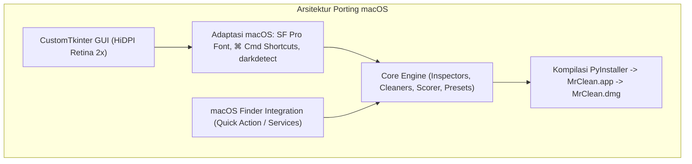

# Blueprint & Implementation Plan — MrClean Versi macOS (Apple Silicon & Intel)

> **DOKUMEN PANDUAN PENGEMBANG (DEVELOPER BLUEPRINT)**
> **PROYEK:** MrClean Mac (MCleanPro macOS Release)
> **PEMILIK PROYEK:** Yogi Ario
> **TARGET PENGEMBANG:** Pengembang Berikutnya di Repositori Baru
> **STATUS:** SIAP DIIMPLEMENTASIKAN (READY FOR DEVELOPMENT)
> **FILOSOFI INTI:** *100% Offline, Zero-Telemetry, Paritas Fitur Lengkap ("Sama Plek" dengan Versi Windows).*

---

## 🏛️ 1. Ringkasan Eksekutif & Tujuan Proyek

Aplikasi **MrClean Mac** adalah porting mandiri dari versi Windows **Mrclean (MCleanPro)** untuk ekosistem **macOS** (mendukung penuh **Apple Silicon M1/M2/M3/M4** maupun prosesor **Intel x86_64**).

Pengembang berikutnya yang mengerjakan repositori ini diwajibkan membangun aplikasi yang memiliki **fitur yang sama persis ("sama plek")**, performa 100% offline, antarmuka modern yang menyatu dengan estetika macOS (Aqua / Human Interface Guidelines), serta terkemas dalam format installer standar Mac (**`.dmg`**) dan bundel aplikasi (**`.app`**).

---

## 📋 2. Matriks Paritas Fitur Wajib ("Sama Plek")

Pengembang wajib memastikan seluruh modul berikut tersedia dan berfungsi penuh di macOS:


|   No   | Modul / Fitur                             | Spesifikasi Teknis                                                                                                                                                                      |  Status Paritas  |
| :------: | :------------------------------------------ | :---------------------------------------------------------------------------------------------------------------------------------------------------------------------------------------- | :----------------: |
| **1** | **Inspeksi Metadata Lengkap**             | Ekstraksi EXIF, GPS, serial number, author, software pada Gambar (JPEG, PNG, WEBP, TIFF), Dokumen (PDF, DOCX), Media (MP3, MP4), dan Teks/Coding.                                       | **WAJIB (100%)** |
| **2** | **Pembersihan Lossless**                  | Menghapus seluruh metadata identitas dan lokasi tanpa mengurangi kualitas piksel gambar atau merusak konten dokumen.                                                                    | **WAJIB (100%)** |
| **3** | **AI Watermark & Steganography Remover**  | Mendeteksi dan memusnahkan karakter tak kasat mata (*invisible zero-width spaces*, joiners, variation selector `\uFE0F`).                                                               | **WAJIB (100%)** |
| **4** | **Privacy Risk Scoring Engine (0–100%)** | Menghitung skor kerentanan privasi berkas (GPS +40, Serial +30, Author +25, Path Lokal +25, dll.) ke level 🔴 KRITIS (≥70%), 🟡 SEDANG (30–69%), dan 🟢 AMAN (<30%).                  | **WAJIB (100%)** |
| **5** | **Quick Clean Presets (Profil Cepat)**    | Tombol sekali klik: 📱 *Media Sosial* (jaga sRGB & rotasi), 🎓 *Akademik* (bersihkan author & AI steganografi), 💻 *Developer/OSS* (samarkan path `/Users/...` & bersihkan zero-width). | **WAJIB (100%)** |
| **6** | **AI Generative & C2PA Forensics**        | Ekstraksi teks prompt asli (Stable Diffusion, Midjourney, DALL-E) dan pembersih khusus manifes C2PA Adobe Content Credentials.                                                          | **WAJIB (100%)** |
| **7** | **Metadata Spoofing (Anonymizer)**        | Penyamaran metadata dengan menyuntikkan profil kamera sintetis realistis (Canon, Nikon, Sony acak) untuk mengelabui detektor anti-stripper.                                             | **WAJIB (100%)** |
| **8** | **Preservative Metadata Editor**          | Dialog penyuntingan selektif untuk mengubah field tertentu (misal: Author saja) dengan mempertahankan 100% tag kamera/resolusi lainnya.                                                 | **WAJIB (100%)** |
| **9** | **Ekspor Laporan Multi-Format**           | Dialog pilihan radio button untuk mengekspor laporan cetak formal **PDF** (via ReportLab dengan kop logo resmi) dan **Markdown** (.md) tabel rapi.                                      | **WAJIB (100%)** |
| **10** | **Multi-Item Selection & Batch Mode**     | Checkbox tiap baris, Master Checkbox `[ ] Pilih Semua`, label counter dinamis `(X dari Y terpilih)`, dan pembersihan batch selektif.                                                    | **WAJIB (100%)** |
| **11** | **Integrasi Sistem Operasi Native Mac**   | macOS Finder Quick Action / Service (menu klik kanan di Finder) dan dukungan drag-and-drop file/folder langsung ke jendela.                                                             | **WAJIB (100%)** |

---

## 🍎 3. Adaptasi Khusus Arsitektur macOS

Meskipun logika backend berbasis Python bersifat lintas platform (*cross-platform*), terdapat penyesuaian wajib untuk ekosistem macOS:



### 3.1 Penyesuaian Antarmuka Pengguna (GUI)

1. **Font Sistem Native:** Gunakan `font=(".AppleSystemUIFont", 12)` atau `SF Pro Text` agar tampilan menyatu mulus dengan macOS Sonoma / Sequoia.
2. **Pintasan Keyboard Apple (Command vs Control):**
   - Pada form input teks (`MetadataEditDialog`), pengguna Mac terbiasa menggunakan tombol `⌘ Command` bukan `Ctrl`.
   - Tambahkan *event binding* untuk Mac:
     ```python
     widget.bind("<Command-c>", lambda e: widget.event_generate("<<Copy>>"))
     widget.bind("<Command-v>", lambda e: widget.event_generate("<<Paste>>"))
     widget.bind("<Command-a>", lambda e: widget.event_generate("<<SelectAll>>"))
     ```
3. **Sinkronisasi Mode Gelap / Terang (Dark/Light):**
   - Gunakan pustaka `darkdetect` untuk mendeteksi perubahan tema sistem macOS secara otomatis tanpa perlu me-restart aplikasi.
4. **Skalasi Layar Retina (HiDPI):**
   - Pastikan aplikasi mendeklarasikan dukungan resolusi tinggi di `Info.plist`:
     ```xml
     <key>NSHighResolutionCapable</key>
     <true/>
     ```

### 3.2 Ekuivalen Menu Klik Kanan: macOS Finder Quick Action / Service

Pada Windows, aplikasi menggunakan Registry `HKCU`. Pada macOS, integrasi klik kanan di Finder diwujudkan melalui:

- **macOS Quick Action (.workflow):**
  - Diletakkan di `~/Library/Services/Bersihkan Metadata dengan MrClean.workflow`.
  - Menerima input berkas/folder dari Finder dan mengeksekusi:
    ```bash
    /Applications/MrClean.app/Contents/MacOS/MrClean "$@"
    ```

### 3.3 Penyamaran Path Direktori pada Preset Developer

Pada Windows, path lokal berupa `C:\Users\username\...`. Pada macOS, sesuaikan regex pembersihan menjadi:

```python
# Samarkan path pengguna macOS (/Users/username/...)
sanitized = re.sub(r"/Users/[^/\s]+", "/Users/user", content)
```

---

## 📦 4. Strategi Packaging & Distribusi macOS

### 4.1 Pembuatan Ikon Apple (`assets/icon.icns`)

macOS mewajibkan format ikon multi-resolusi `.icns`. Skrip konversi wajib disiapkan untuk mengubah `Material/logo.jpg` menjadi `icon.icns` menggunakan utilitas bawaan Mac `iconutil`:

```bash
# Workflow pembuatan .icns dari logo.jpg (di Mac)
mkdir icon.iconset
sips -z 16 16     logo.png --out icon.iconset/icon_16x16.png
sips -z 32 32     logo.png --out icon.iconset/icon_16x16@2x.png
sips -z 32 32     logo.png --out icon.iconset/icon_32x32.png
sips -z 64 64     logo.png --out icon.iconset/icon_32x32@2x.png
sips -z 128 128   logo.png --out icon.iconset/icon_128x128.png
sips -z 256 256   logo.png --out icon.iconset/icon_128x128@2x.png
sips -z 256 256   logo.png --out icon.iconset/icon_256x256.png
sips -z 512 512   logo.png --out icon.iconset/icon_256x256@2x.png
sips -z 512 512   logo.png --out icon.iconset/icon_512x512.png
sips -z 1024 1024 logo.png --out icon.iconset/icon_512x512@2x.png
iconutil -c icns icon.iconset -o assets/icon.icns
rm -R icon.iconset
```

### 4.2 Skrip Kompilasi Mandiri (`build_mac.py`)

Skrip untuk membangun bundel `dist/MrClean.app` dan membungkusnya menjadi `dist/MrClean-macOS.dmg`:

```python
"""
MrClean Mac — Build & Packaging Script (.app & .dmg)
"""
import os
import sys
import subprocess
import shutil

def build_mac():
    print("[*] MEMULAI KOMPILASI MRCLEAN UNTUK MACOS...")
  
    # 1. Jalankan PyInstaller untuk membuat .app bundle
    cmd = [
        sys.executable, "-m", "PyInstaller",
        "--windowed",
        "--onedir",
        "--name=MrClean",
        "--icon=assets/icon.icns",
        "--collect-all=customtkinter",
        "--collect-all=reportlab",
        "--add-data=assets:assets",
        "--clean",
        "-y",
        "src/main.py"
    ]
    subprocess.run(cmd, check=True)

    app_path = "dist/MrClean.app"
    dmg_path = "dist/MrClean-macOS.dmg"

    # 2. Kemas menjadi berkas DMG menggunakan utilitas native macOS (hdiutil)
    if os.path.exists(app_path):
        print("[*] Mengemas MrClean.app ke berkas disk image (.dmg)...")
        if os.path.exists(dmg_path):
            os.remove(dmg_path)

        dmg_cmd = [
            "hdiutil", "create",
            "-volname", "MrClean Installer",
            "-srcfolder", "dist/MrClean.app",
            "-ov",
            "-format", "UDZO",
            dmg_path
        ]
        subprocess.run(dmg_cmd, check=True)
        print(f"[SUCCESS] Berkas installer macOS berhasil dibuat: {dmg_path}")

if __name__ == "__main__":
    build_mac()
```

### 4.3 Panduan Gatekeeper Apple (Distribusi Bebas Biaya Tanpa Apple Developer \$99)

Karena aplikasi didistribusikan secara independen (*open source* / offline) tanpa sertifikat berbayar Apple Developer Program (\$99/tahun), macOS Gatekeeper akan menampilkan peringatan keamanan saat pertama kali dibuka.

Sertakan instruksi ini di file `README.md` repositori Mac:

> **Cara Menjalankan MrClean di macOS:**
>
> 1. Unduh dan buka berkas `MrClean-macOS.dmg`.
> 2. Geser icon `MrClean.app` ke folder `/Applications`.
> 3. Saat pertama kali membuka, jika muncul pesan *"Apple cannot check it for malicious software"*:
>    - Buka **System Settings (Pengaturan Sistem)** -> **Privacy & Security (Privasi & Keamanan)**.
>    - Gulir ke bawah, lalu klik tombol **"Open Anyway (Tetap Buka)"**.
>    - *Atau cukup jalankan perintah terminal sekali:*
>      `xattr -cr /Applications/MrClean.app`

---

## ☁️ 5. Pilihan Kompilasi: Cloud GitHub Actions (Tanpa Perangkat Mac Fisik)

Jika pengembang atau Mas Yogi tidak memiliki laptop Mac fisik, proses kompilasi dapat dijalankan secara **100% GRATIS dan OTOMATIS** menggunakan runner macOS milik GitHub Actions.

Buatkan file alur kerja di repositori Mac: `.github/workflows/build-mac.yml`

```yaml
name: Build MrClean macOS (.dmg)

on:
  push:
    branches: [ main, develop ]
    tags: [ 'v*' ]
  workflow_dispatch:

jobs:
  build-macos:
    runs-on: macos-latest # Menjalankan runner native Apple Silicon M-series
    steps:
      - name: Checkout Repository
        uses: actions/checkout@v4

      - name: Setup Python
        uses: actions/setup-python@v5
        with:
          python-version: '3.13'

      - name: Install Dependencies
        run: |
          python -m pip install --upgrade pip
          pip install -r requirements.txt
          pip install pyinstaller

      - name: Run Unit Tests
        run: |
          python -m unittest discover -s tests -p "test_*.py" -v

      - name: Build Application (.app & .dmg)
        run: |
          python build_mac.py

      - name: Upload DMG Artifact
        uses: actions/upload-artifact@v4
        with:
          name: MrClean-macOS-Installer
          path: dist/MrClean-macOS.dmg
```

---

## 🚀 6. Panduan Tahapan Pengerjaan untuk Pengembang Baru (Batches)

Pengembang berikutnya disarankan mengeksekusi proyek ini dalam 6 Batch terstruktur:

### 📌 Batch 1: Inisialisasi Repositori & Core Engine

- Buat repositori baru `MrClean-Mac`.
- Salin struktur backend yang sudah 100% platform-agnostic:
  - `src/inspectors/` (`image_inspector.py`, `pdf_inspector.py`, `docx_inspector.py`, `media_inspector.py`, `text_inspector.py`, `risk_scorer.py`, `ai_forensics.py`).
  - `src/cleaners/` (`image_cleaner.py`, `pdf_cleaner.py`, `docx_cleaner.py`, `media_cleaner.py`, `text_cleaner.py`, `preset_cleaner.py`, `c2pa_cleaner.py`).
  - `src/editors/` (`image_editor.py`, `pdf_editor.py`, `docx_editor.py`, `media_editor.py`, `spoofing.py`).
  - `src/watermarks/` (`ai_cleaner.py`).
  - `src/utils/` (`scanner.py`, `exporter.py`, `md_exporter.py`, `pdf_exporter.py`).
- Jalankan test suite (`python -m unittest discover -s tests`). Pastikan 100% PASS.

### 📌 Batch 2: Adaptasi Antarmuka GUI (CustomTkinter macOS)

- Porting file `src/gui/app.py` dan modal dialog (`export_dialog.py`, `edit_dialog.py`).
- Sesuaikan font ke font native Apple, aktifkan event copy-paste `⌘ Command`, dan pastikan dukungan Retina Display.
- Uji rendering Dark/Light mode di macOS.

### 📌 Batch 3: Integrasi Finder Quick Action & macOS Notifications

- Buat modul `src/utils/mac_shell_integration.py` untuk menginstal layanan Finder Quick Action di `~/Library/Services/`.
- Integrasikan notifikasi sistem native macOS menggunakan `osascript` saat proses batch cleaning selesai.

### 📌 Batch 4: Aset Ikon Apple (`icon.icns`)

- Siapkan skrip konversi aset untuk memproduksi `assets/icon.icns` dari `Material/logo.jpg`.

### 📌 Batch 5: Packaging Standalone `build_mac.py` & `.dmg`

- Uji eksekusi `python build_mac.py` untuk menghasilkan `dist/MrClean.app` dan `dist/MrClean-macOS.dmg`.
- Verifikasi bahwa aplikasi dapat dibuka, berkas dapat ditarik (*drag and drop*), dan seluruh fitur berjalan secara offline.

### 📌 Batch 6: Konfigurasi GitHub Actions & Rilis Publik

- Pasang `.github/workflows/build-mac.yml`.
- Rilis versi `v1.0.0-macos` dengan menyertakan berkas `.dmg` pada halaman GitHub Releases.

---

## ✅ 7. Kriteria Penyelesaian (Definition of Done)

Proyek MrClean Mac dinyatakan **SELESAI 100%** jika:

1. Seluruh 11 fitur wajib beroperasi secara identik dengan versi Windows.
2. Seluruh unit tests menghasilkan status **100% PASS (0 GAGAL / 0 ERROR)**.
3. Aplikasi terdistribusi dalam bentuk berkas mandiri **`MrClean-macOS.dmg`** yang siap pakai tanpa perlu instalasi Python manual oleh pengguna akhir.
4. Aplikasi bekerja secara **100% offline** tanpa mengirim data apa pun keluar dari komputer pengguna.
