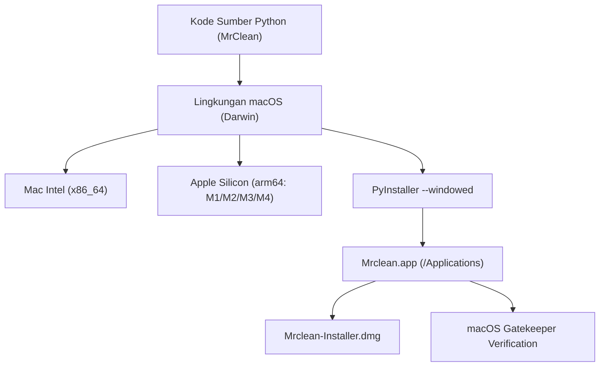

# Rincian Proyek & Kebutuhan Pengembang macOS (MrClean / MCleanPro)

> **DOKUMEN SPESIFIKASI:** Panduan Arsitektur & Lingkungan Khusus macOS
> **PROYEK:** Mrclean / MCleanPro (Offline Metadata & AI Watermarks Remover)
> **PEMILIK PROYEK:** Yogi Ario
> **TARGET PENGEMBANG:** macOS Developer & DevOps CI/CD
> **STATUS:** DRAFT SPESIFIKASI

---

## 1. Ringkasan Ekosistem macOS

MrClean dirancang sebagai aplikasi desktop Python murni yang bersifat *cross-platform*. Untuk menghadirkan pengalaman pengguna macOS yang mulus (*native look-and-feel*), terdapat karakteristik arsitektural dan lingkungan sistem operasi yang harus dipenuhi oleh pengembang khusus macOS.



---

## 2. Kebutuhan Prasyarat Pengembang (Prerequisites)

Bagi pengembang yang bekerja di lingkungan macOS, berikut adalah alat dan dependensi sistem yang wajib terpasang:

### 2.1 Alat Sistem Dasar (CLI Tools)

1. **macOS Version:** macOS 11 (Big Sur), macOS 12 (Monterey), macOS 13 (Ventura), macOS 14 (Sonoma), atau macOS 15 (Sequoia).
2. **Xcode Command Line Tools:**
   ```bash
   xcode-select --install
   ```
3. **Homebrew (Mac Package Manager):**
   ```bash
   /bin/bash -c "$(curl -fsSL https://raw.githubusercontent.com/Homebrew/install/HEAD/install.sh)"
   ```

### 2.2 Lingkungan Python & Tkinter Khusus macOS

Berbeda dengan Windows di mana Tkinter sudah terbundel secara otomatis dalam installer resmi Python, pada macOS Tkinter memerlukan penanganan khusus:

* **Pemasangan Python via Homebrew dengan Tkinter:**

  ```bash
  brew install python@3.13 python-tk@3.13
  ```

  *(Catatan: `python-tk` sangat penting agar CustomTkinter dapat berjalan tanpa galat `No module named '_tkinter'`)*.

### 2.3 Perkakas Pembuat Aset Ikon & Installer Mac

1. **`iconutil` (Bawaan macOS):** Digunakan untuk mengemas folder iconset menjadi berkas `.icns` multi-resolusi (16x16, 32x32, 64x64, 128x128, 256x256, 512x512, 1024x1024 @2x Retina).
2. **`hdiutil` (Bawaan macOS):** Digunakan untuk membuat berkas Apple Disk Image (`.dmg`).
3. **`create-dmg` (Opsional untuk installer cantik dengan background dan drag-to-Applications):**
   ```bash
   brew install create-dmg
   ```

---

## 3. Penyesuaian Antarmuka & UX Khusus macOS

Aplikasi CustomTkinter di macOS memiliki beberapa perbedaan perilaku dibandingkan Windows:

### 3.1 Retina Display & Font Rendering

- Layar Retina Mac memiliki kepadatan piksel tinggi (*High DPI 2x*).
- Pada `src/gui/app.py`, properti font dan logo `assets/logo.png` harus dipastikan memiliki resolusi cukup tinggi agar tidak terlihat buram (*blurry*).
- Font sistem bawaan macOS yang direkomendasikan adalah **San Francisco (`.AppleSystemUIFont` / `SF Pro Text`)**.

### 3.2 Penanganan Appearance (Dark / Light Mode)

- macOS memiliki tema global yang dikontrol oleh sistem operasi.
- Pustaka `darkdetect` yang digunakan oleh CustomTkinter secara otomatis mendeteksi perubahan tema macOS secara *real-time* (Light, Dark, atau Auto).

### 3.3 Penanganan Pintasan Keyboard (Command vs Control)

- Pada Windows: `Ctrl+O` (Buka berkas), `Ctrl+C` (Salin), `Ctrl+V` (Tempel).
- Pada macOS: Pengguna terbiasa menggunakan tombol **Command (`⌘` / `<Command-Key>`)**.
- Perlu dipastikan *event binding* Tkinter menangani `<Command-v>` dan `<Command-c>` pada dialog form `MetadataEditDialog`.

### 3.4 Menu Bar & Dock

- Di macOS, menu aplikasi tidak menempel di jendela aplikasi, melainkan berada di Menu Bar atas layar.
- PyInstaller flag `--windowed` memastikan aplikasi muncul dengan ikon resmi di macOS Dock dan tidak memunculkan jendela terminal Terminal.app.

---

## 4. Mekanisme Keamanan macOS (Gatekeeper & Quarantine)

Apple menerapkan proteksi ketat untuk aplikasi yang diunduh di luar Mac App Store:

### 4.1 Status Aplikasi Tanpa Sertifikat Berbayar (Unsigned)

Jika aplikasi didistribusikan tanpa Apple Developer ID Certificate (\$99/tahun):

1. macOS akan memblokir peluncuran perdana dengan dialog:
   *"Mrclean.app cannot be opened because the developer cannot be verified."*
2. **Solusi untuk Pengguna:**
   - **Metode GUI:** Klik kanan (Control-klik) pada `Mrclean.app` -> Pilih **Open** -> Klik **Open Anyway**.
   - **Metode Terminal:** Jalankan perintah pembersihan atribut karantina:
     ```bash
     xattr -cr /Applications/Mrclean.app
     ```

### 4.2 Alur Signing & Notarisasi Resmi (Jika Tersedia Sertifikat Apple)

Jika Mas Yogi memiliki akun Apple Developer berbayar di masa depan:

```bash
# 1. Code signing
codesign --deep --force --verify --verbose --sign "Developer ID Application: Yogi Ario (TEAM_ID)" Mrclean.app

# 2. Notarisasi ke server Apple
xcrun notarytool submit Mrclean.dmg --keychain-profile "AC_PASSWORD" --wait

# 3. Stapling tiket notarisasi ke berkas DMG
xcrun stapler staple Mrclean.dmg
```

---

## 5. Ringkasan Kebutuhan Struktur Direktori Mac

```text
cek metadata/
├── Material/                         # [READ-ONLY] Aset mentah (logo.jpg & img.png)
├── assets/
│   ├── icon.ico                      # Windows Icon
│   ├── icon.icns                     # [KHUSUS MAC] Apple Icon Image
│   └── logo.png                      # Header logo
│
├── Docs/
│   ├── Mac/                          # [KHUSUS MAC] Dokumentasi & Rencana Mac
│   │   ├── Project_Overview_Mac.md   # Dokumen spesifikasi ini
│   │   └── Implementation_plan_mac.md # Rencana kerja implementasi Mac
│   └── universal-rule.md
│
├── build_mac.py                      # [KHUSUS MAC] Skrip build PyInstaller .app & .dmg
└── .github/
    └── workflows/
        └── build-mac.yml             # [KHUSUS MAC] GitHub Actions Auto-Build CI/CD
```
