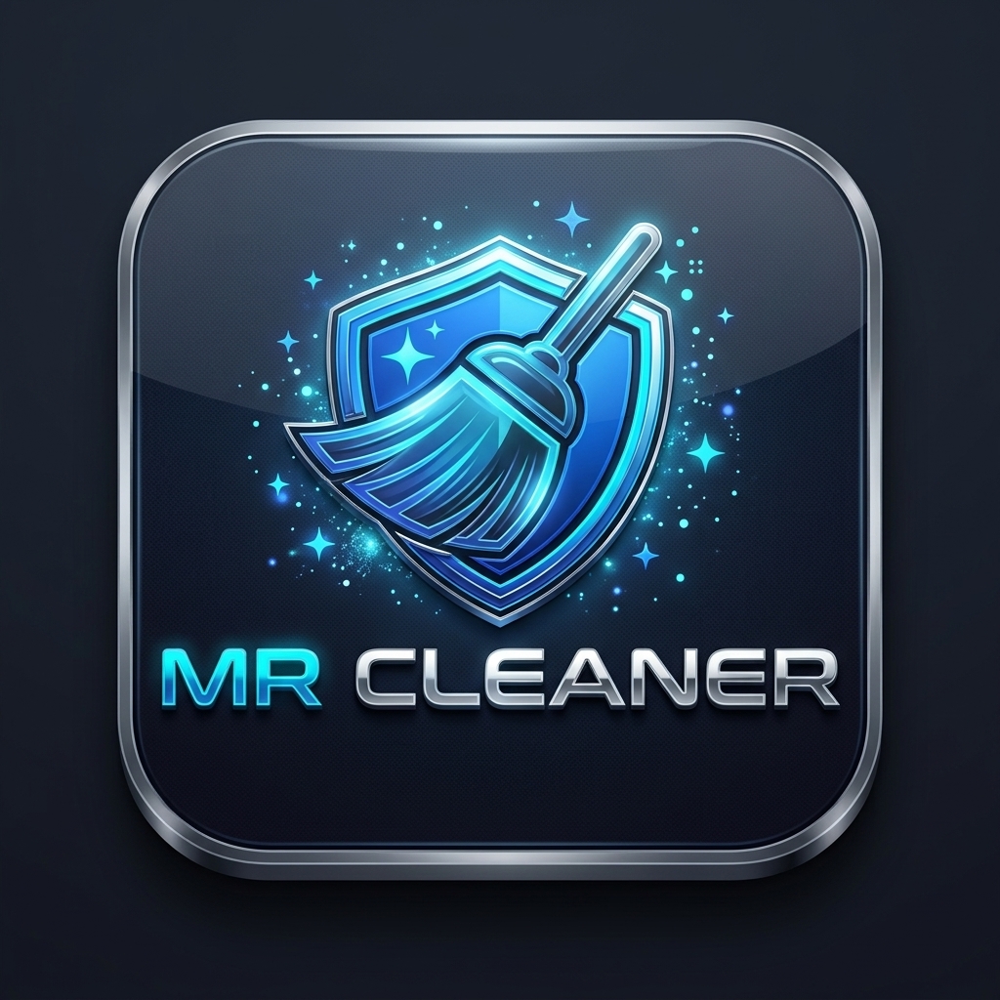

<p align="center">
  
</p>

<h1 align="center">MrClean Mac (MCleanPro)</h1>

<p align="center">
  <strong>Offline Metadata Inspector, Cleaner, Presets & AI Watermarks Remover — Edisi Khusus macOS</strong>
</p>

<p align="center">
  <a href="https://github.com/useripx/McClean-Mac"></a>
  <a href="https://github.com/useripx/McClean-Mac/network/members"></a>
  <a href="https://github.com/useripx/McClean-Mac/stargazers"></a>
  <a href="https://github.com/useripx/McClean-Mac/issues"></a>
  <a href="LICENSE"></a>
  <br/>
  
  
  
</p>

---

## 📖 Tentang MrClean Mac

**MrClean Mac** adalah aplikasi desktop inspeksi, pembersih metadata, forensik generative AI, dan penghapus *watermark* tersembunyi yang dioptimalkan khusus untuk ekosistem **macOS** (Apple Silicon M1/M2/M3/M4 dan Intel x86_64).

Dibangun di atas prinsip **100% Offline & Zero-Telemetry**, seluruh proses analisis dan manipulasi berkas berlangsung secara lokal di memori Mac Anda tanpa ada satu pun bita data yang dikirimkan ke server eksternal.

---

## 🚀 Fitur Unggulan (Paritas Lengkap)

Aplikasi ini menghadirkan 11 modul utama yang teruji secara komprehensif:

1. **🔍 Inspeksi Metadata Lengkap (Deep Inspector):**
   - Mendukung berkas Gambar (`.jpg`, `.jpeg`, `.png`, `.webp`, `.tiff`), Dokumen (`.pdf`, `.docx`), Audio/Video (`.mp3`, `.mp4`), serta Teks/Kode sumber.
   - Mengekstrak informasi tersembunyi: koordinat GPS, nomor seri kamera/lensa, identitas pembuat (author), riwayat perangkat lunak, hingga tanggal modifikasi.

2. **🧹 Pembersihan Lossless (Lossless Cleaner):**
   - Menghapus seluruh tag EXIF, XMP, IPTC, dan metadata identitas tanpa mengompresi atau mengurangi kualitas piksel gambar dan isi dokumen asli.

3. **🕵️ AI Watermark & Steganography Remover:**
   - Mendeteksi dan membersihkan karakter tak kasat mata (*zero-width spaces*, joiners, variation selector `\uFE0F`, dan steganografi teks tak terlihat) yang disisipkan oleh AI teks dan detektor konten.

4. **⚠️ Privacy Risk Scoring Engine (0–100%):**
   - Menganalisis tingkat kerentanan privasi berkas secara cerdas:
     - 🔴 **KRITIS (≥ 70%):** Mengandung koordinat GPS presisi dan nomor seri hardware.
     - 🟡 **SEDANG (30–69%):** Mengandung author, nama perangkat lunak, dan path internal.
     - 🟢 **AMAN (< 30%):** Bersih dari data pribadi sensitif.

5. **⚡ Quick Clean Presets (Profil Sekali Klik):**
   - 📱 **Media Sosial:** Menghapus data sensitif tetapi menjaga profil warna sRGB dan orientasi rotasi gambar.
   - 🎓 **Akademik & Jurnal:** Menghapus nama pengarang, afiliasi, komentar revisi, dan jejak steganografi teks.
   - 💻 **Developer / OSS:** Menyamarkan path pengguna Mac (`/Users/username/...` menjadi `/Users/user`) dan membersihkan zero-width tokens.

6. **🎨 AI Generative & C2PA Forensics:**
   - Mengekstrak metadata prompt generasi gambar AI (Stable Diffusion, Midjourney, DALL-E, ComfyUI).
   - Menemukan dan memusnahkan manifes Adobe Content Credentials (C2PA).

7. **🎭 Metadata Spoofing (Anonymizer):**
   - Menyamarkan berkas dengan menyuntikkan profil metadata kamera sintetis yang realistis (Canon EOS, Nikon D850, Sony Alpha acak) untuk mengecoh detektor *anti-stripping*.

8. **✏️ Preservative Metadata Editor:**
   - Dialog penyuntingan selektif yang memungkinkan Anda mengubah atribut tertentu (misal: Author atau Copyright) dengan tetap mempertahankan 100% struktur data lainnya.

9. **📊 Ekspor Laporan Multi-Format:**
   - Cetak laporan formal berformat **PDF** (dilengkapi kop logo resmi via ReportLab) dan format **Markdown (.md)** tabel rapi untuk keperluan audit forensik.

10. **☑️ Multi-Item Selection & Batch Mode:**
    - Pembersihan puluhan berkas secara serentak dengan fitur *Checkbox Tiap Baris*, *Pilih Semua*, dan kalkulasi risiko massal.

11. **🍎 Integrasi Native macOS:**
    - **Finder Quick Action (Menu Klik Kanan):** Bersihkan berkas langsung dari Finder Mac.
    - **Apple Keyboard Shortcuts:** Mendukung penuh `⌘ Command+C`, `⌘ Command+V`, `⌘ Command+A`, dan `⌘ Command+Q`.
    - **Retina Display (HiDPI 2x):** Tampilan tajam dan anti-buram dengan font sistem Apple San Francisco (`.AppleSystemUIFont` / `SF Pro Text`).
    - **Auto Dark/Light Mode:** Sinkronisasi dinamis mengikuti preferensi tema sistem macOS melalui `darkdetect`.

---

## 💻 Panduan Instalasi & Penggunaan di macOS

### Cara 1: Menggunakan Berkas Installer Disk Image (`.dmg`) [Disarankan]

1. Unduh berkas installer terbaru **`MrClean-macOS.dmg`** dari menu [Releases](https://github.com/useripx/McClean-Mac/releases).
2. Buka berkas `.dmg`, lalu seret ikon **`MrClean.app`** ke dalam folder **`/Applications`**.
3. **Peringatan Apple Gatekeeper (Aplikasi Unsigned):**  
   Karena aplikasi ini bersifat *open-source* dan didistribusikan secara mandiri tanpa sertifikat berbayar Apple Developer (\$99/tahun), macOS Gatekeeper akan menampilkan peringatan keamanan saat pertama kali dibuka.
   - **Solusi GUI:** Buka **System Settings (Pengaturan Sistem)** ➜ **Privacy & Security (Privasi & Keamanan)** ➜ Gulir ke bawah dan klik tombol **"Open Anyway (Tetap Buka)"**.
   - **Solusi Terminal (Cepat):** Jalankan perintah berikut sekali saja di Terminal:
     ```bash
     xattr -cr /Applications/MrClean.app
     ```

---

### Cara 2: Menjalankan dari Kode Sumber (Developer)

#### Prasyarat Sistem macOS:
1. Pasang **Homebrew** dan **Python 3.13** beserta paket Tkinter:
   ```bash
   brew install python@3.13 python-tk@3.13
   ```
2. Clone repositori:
   ```bash
   git clone https://github.com/useripx/McClean-Mac.git
   cd McClean-Mac
   ```
3. Buat dan aktifkan virtual environment:
   ```bash
   python3 -m venv venv
   source venv/bin/activate
   ```
4. Pasang dependensi:
   ```bash
   pip install -r requirements.txt
   ```
5. Jalankan aplikasi:
   ```bash
   python3 src/main.py
   ```

---

## 🛠️ Kompilasi Mandiri (`build_mac.py`)

Untuk membangun bundel `MrClean.app` dan installer `MrClean-macOS.dmg` di lingkungan macOS lokal:

```bash
# Pastikan PyInstaller terpasang
pip install pyinstaller

# Jalankan skrip packaging
python3 build_mac.py
```

Hasil kompilasi akan berada di folder `dist/`:
- `dist/MrClean.app`
- `dist/MrClean-macOS.dmg`

> **Kompilasi Otomatis via Cloud:**  
> Repositori ini dilengkapi dengan **GitHub Actions Workflow** (`.github/workflows/build-mac.yml`) yang secara otomatis menguji unit test dan mengompilasi biner macOS di cloud runner `macos-latest` (Apple Silicon) setiap kali ada push/tag rilis baru.

---

## 🗺️ Peta Jalan Pengembangan (Roadmap)

Peta jalan pengembangan produk MrClean Mac terbagi dalam 4 fase strategis:
- 🟢 **Fase 1 (v1.0.0-macos):** Pondasi 11 Fitur Paritas Penuh, Test Suite 100% PASS (44 Tests), GUI Apple San Francisco, Finder Quick Action, Aset Apple ICNS, Packaging DMG & GitHub Actions CI/CD. *(SELESAI)*
- 🟡 **Fase 2 (v1.1.0-macos):** Publikasi Rilis GitHub DMG, Universal 2 Fat Binary (`arm64` + `x86_64`), Stylized DMG Installer, dan Drag & Drop native. *(Fokus Saat Ini)*
- 🔵 **Fase 3 (v1.2.0-macos):** Dukungan format RAW Kamera (Sony ARW, Canon CR3, Nikon NEF), Telemetri Drone GPS, dan Viewer Peta Offline. *(Q1 2027)*
- 🟣 **Fase 4 (v2.0.0-macos):** macOS Menu Bar Status Item App, Apple Shortcuts Integration, Homebrew Tap Distribution, dan Apple Notarization. *(Q2 2027)*

> 📖 *Dokumen rinci roadmap dapat ditinjau di [Docs/Roadmap.md](Docs/Roadmap.md).*

---

## 🏛️ Tata Kelola & Standar Kerja (8 Pilar Universal)

Proyek ini dikembangkan dengan mematuhi **Master Framework Governance**:

- **Pilar 1: ZERO-CODE Approval Gate** — *No Plan, No Code. No Approval, No Code.*
- **Pilar 2: Clean `main` Branch** — Branch `main` murni memuat kode runtime produksi, seluruh dokumentasi pengembangan berada di branch `develop`.
- **Pilar 3: Zero Leakage** — Perlindungan `.gitignore` ketat terhadap berkas sistem macOS (`.DS_Store`) dan kredensial.
- **Pilar 4: Asset Protection** — Aset mentah dilindungi, format ikon resmi menggunakan standar Apple `assets/icon.icns`.
- **Pilar 5: Documentation-First** — Pembaruan berkala di `Docs/Task_Status.md`, `Docs/Decision_Log.md`, dan changelog bertimestamp.
- **Pilar 6: 100% Automated Testing Gate** — Rilis hanya diizinkan jika seluruh unit tests di `tests/` menghasilkan 100% PASS.
- **Pilar 7: Native macOS Lean Architecture** — Desain ramah sumber daya, performa tinggi, dan patuh HIG Apple.
- **Pilar 8: Proactive Communications** — Kolaborasi transparan dan pencadangan riwayat kerja berkala.

---

## 📄 Lisensi & Kepemilikan

Proyek ini dibuat dan dikelola oleh **Yogi Ario**.  
Dilisensikan di bawah lisensi **MIT** — lihat berkas [LICENSE](LICENSE) untuk rincian lengkap.
