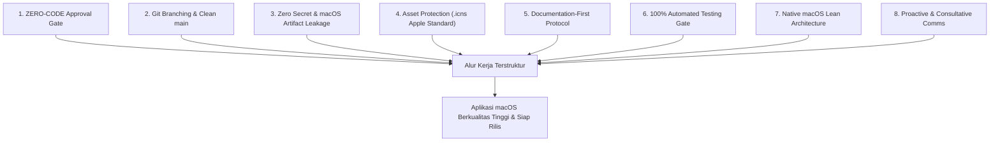

# UNIVERSAL-RULE.md — Kerangka Standar Kerja Pengembangan Proyek & AI Agent (Edisi macOS)

> **STATUS:** DOKUMEN STANDAR UNIVERSAL RESMI (MASTER FRAMEWORK MACOS)  
> **PROYEK:** MrClean Mac — Offline Metadata Inspector, Cleaner & AI Watermarks Remover (macOS Release)  
> **OTORITAS TERTINGGI:** Yogi Ario (PROJECT OWNER / LEAD DEVELOPER)  
> **TARGET PENGGUNA:** Seluruh Pengembang (Human Developer) & AI Agent (Antigravity, Gemini, Claude, Cursor, dll.)  
> **REUSABILITAS:** Wajib diterapkan pada repositori MrClean Mac yang dikelola oleh: Yogi Ario.  

---

## 📖 Pendahuluan & Filosofi Kerja

Dokumen ini adalah **pedoman tata kelola universal (Universal Governance Framework)** yang dirancang untuk menjaga kualitas, keamanan, transparansi, dan kerapian pengerjaan software engineering dari awal hingga rilis produksi pada ekosistem **macOS** (Apple Silicon M1/M2/M3/M4 & Intel).

### 🧭 Core Philosophy: Consistent Standards, Variable Intelligence

> **"AI may vary in intelligence. Project standards must remain consistent."**

Kualitas penalaran, kemampuan mempertahankan konteks, dan keandalan eksekusi setiap AI Agent dapat berbeda-beda. Karena itu, proses pengembangan tidak boleh bergantung pada asumsi bahwa AI Agent akan selalu memahami instruksi atau menghasilkan pekerjaan dengan kualitas yang sama. **Standar kerja, gerbang persetujuan, dokumentasi, dan bukti pengujian harus tetap konsisten**, siapa pun AI Agent atau pengembang yang mengerjakannya.

Prinsip operasional yang menjadi dasar kerangka ini:

- **No Plan, No Code.** Rencana tertulis (*Implementation Plan*) harus tersedia sebelum perubahan dilakukan.
- **No Approval, No Code.** Perubahan yang memerlukan persetujuan tidak boleh dijalankan sebelum persetujuan eksplisit diberikan oleh Yogi Ario.
- **No Evidence, No Completion.** Pekerjaan tidak boleh dinyatakan selesai tanpa bukti verifikasi pengujian 100% PASS.
- **No Superfluous AI Boilerplate:** Jangan menambahkan elemen formalitas tambahan, blok komentar yang tidak perlu, atau *boilerplate* artifisial yang tidak ada pada panduan penugasan agar kode tetap natural, otentik, dan efisien.

Setiap AI Agent atau pengembang yang memulai sesi pada repositori MrClean Mac **WAJIB membaca, memahami, dan mematuhi 8 Pilar Standar Kerja** berikut tanpa terkecuali.

---

## 🏛️ Delapan Pilar Standar Kerja Universal (macOS Edition)



---

### 🛑 Pilar 1: ZERO-CODE Sebelum Persetujuan Rencana (Approval Gate)

**Prinsip Inti:** *No Plan, No Code. No Approval, No Code. No Evidence, No Completion.*

1. **Dilarang Keras Menyentuh Kode Terlebih Dahulu:**
   - Jangan pernah membuat, mengedit, atau menghapus file kode aplikasi sebelum menyusun rencana kerja tertulis dan memperoleh **persetujuan eksplisit** dari Yogi Ario.
2. **Format Wajib Implementation Plan:**
   Setiap kali ada instruksi, fitur baru, adaptasi modul, atau perbaikan bug, buatlah dokumen rencana (*Implementation Plan*) yang memuat:
   - **Tujuan & Ruang Lingkup:** Apa yang ingin dicapai pada ekosistem macOS.
   - **Analisis & Pilihan Solusi:** Tawarkan opsi jika ada trade-off teknis khusus Mac.
   - **Daftar File Target:** File mana yang akan dibuat, dimodifikasi, atau diuji.
   - **Alur Pengujian:** Bagaimana cara membuktikan bahwa fitur bekerja dan bebas regresi.
3. **Gerbang Persetujuan (Approval Gate):**
   - AI Agent wajib berhenti dan menunggu konfirmasi eksplisit dari Yogi Ario (misal: "Oke disetujui", "Lanjut", atau respon positif serupa) sebelum menyentuh kode.

---

### 🌿 Pilar 2: Protokol Branching Git & Kebijakan Kebersihan Branch `main`

**Prinsip Inti:** *Branch `main` adalah Mahkota Produksi Bersih — Hanya Memuat Kode Runtime.*

1. **Branch `main` (Produksi Tertutup & Bersih):**
   - Berisi kode stabil rilis produksi macOS (`src/`, `assets/`, `Material/`, `requirements.txt`, `README.md`, `LICENSE`, `build_mac.py`).
   - **DILARANG KERAS** memuat file catatan internal pengembang (`Docs/`, `changelog/`, `AGENTS.md`, `GEMINI.md`) di branch `main`. Seluruh catatan pengembang dibatasi mentok sampai branch `develop`.
   - Dilarang commit atau push langsung ke `main`. Merge dilakukan via rilis terfilter (`tools/sync_to_main.py` atau PR resmi).
2. **Branch `develop` (Branch Integrasi Utama):**
   - Seluruh pembaruan, perbaikan, dan fitur baru yang telah lulus uji wajib digabungkan ke `develop` dan di-push ke `origin develop`.
   - Dokumentasi lengkap (`Docs/`, `changelog/`) dipelihara di branch ini.
3. **Branch Fitur (`feature/<nama-fitur>` / `fix/<nama-bug>`):**
   - Setiap pekerjaan mandiri wajib dibuatkan branch tersendiri yang bercabang dari `develop`.
   - Setelah pekerjaan selesai dan lulus uji 100%, branch fitur digabungkan (*merge*) kembali ke `develop`.

---

### 🔐 Pilar 3: Keamanan Kunci Rahasia & Perlindungan `.gitignore` (Zero Leakage)

**Prinsip Inti:** *Kunci Rahasia dan Berkas Sampah macOS Dilarang Masuk ke Repositori.*

1. **Perlindungan `.gitignore` Komprehensif Sejak Menit Pertama:**
   - Wajib menyaring berkas sampah sistem operasi macOS:
     - `.DS_Store`
     - `._*`
     - `.AppleDouble`
     - `.Spotlight-V100`
     - `.Trashes`
   - Serta berkas rahasia dan build biner:
     - `.env`, `.env.local`
     - `build/`, `dist/`, `*.app`, `*.dmg`, `*.pkg`, `*.spec`
     - `__pycache__/`, `*.pyc`, `.pytest_cache/`
2. **Larangan Kebocoran Kunci:**
   - Jangan pernah menuliskan nilai kunci API atau token rahasia ke dalam prompt, commit message, atau file kode.
3. **Template Konfigurasi Bersih (`.env.example`):**
   - Sediakan berkas `.env.example` dummy jika di masa depan terdapat konfigurasi lingkungan.

---

### 🎨 Pilar 4: Proteksi Integritas Aset Desain & Standar Apple (`icon.icns`)

**Prinsip Inti:** *Aset Asli Bersifat Read-Only; Format Ikon Mengikuti Standar Apple.*

1. **Status READ-ONLY untuk Folder `Material/`:**
   - Berkas mentah seperti `Material/logo.jpg` dan `Material/img.png` yang disediakan Yogi Ario dilarang diubah, ditimpa, atau dihapus oleh AI Agent / Developer.
2. **Konversi ke Format Standar Apple (`assets/icon.icns`):**
   - Untuk macOS, aset icon tidak menggunakan `.ico`, melainkan format multi-resolusi Apple **`.icns`** (16x16, 32x32, 64x64, 128x128, 256x256, 512x512, hingga 1024x1024 Retina) yang dihasilkan dari `Material/logo.jpg`.
   - Gunakan skrip konversi aset atau utilitas macOS `iconutil` / `Pillow`.

---

### 📝 Pilar 5: Protokol Dokumentasi Wajib (Documentation-First)

**Prinsip Inti:** *Kode Tanpa Dokumentasi adalah Utang Teknis di Masa Depan.*

Setiap repositori macOS wajib memiliki folder `Docs/` dan folder `changelog/` yang selalu diperbarui:

| Nama Berkas | Lokasi | Fungsi & Aturan Pembaruan |
| :--- | :--- | :--- |
| **`Task_Status.md`** | `Docs/Task_Status.md` | Melacak status seluruh fase proyek, persentase progres, dan checklist tugas real-time. |
| **`Decision_Log.md`** | `Docs/Decision_Log.md` | Mencatat seluruh keputusan teknis/arsitektur (ADR: ID, Tanggal, Topik, Keputusan, Rationale). |
| **`API_Contract.md`** | `Docs/API_Contract.md` | Kontrak spesifikasi sistem (Aplikasi Desktop Offline 100%). |
| **Changelog Bertimestamp** | `changelog/changelog<jam><ampm><ddmmyyyy>.md` | Catatan perubahan bertimestamp waktu lokal per batch rilis atau tugas selesai. **Wajib flat** (disimpan langsung di dalam folder `changelog/`, dilarang membuat subfolder). Format: 2 digit jam (`03am` / `02pm`, huruf am/pm kecil) dan 8 digit tanggal (`ddmmyyyy`). Contoh: `changelog/changelog08pm10112026.md`. |
| **Cadangan Riwayat Chat** | `Docs/chat/riwayat<ddmmyyyy>.md` | Arsip berkala riwayat percakapan interaktif antara pengguna dan AI Agent dari awal hingga akhir sesi. |

---

### 🧪 Pilar 6: Gerbang Verifikasi Pengujian (100% Automated Testing Gate)

**Prinsip Inti:** *Jangan Pernah Bilang Selesai Jika Belum Terbukti Lulus Uji.*

1. **Wajib Memiliki Test Suite Otomatis Lengkap:**
   - Seluruh modul inti (Inspectors, Cleaners, AI Watermarks, Risk Scorer, Presets, Forensics, Spoofing, Exporters, Multi-Select) wajib memiliki pengujian unit di folder `tests/`.
2. **Definisi Selesai (Definition of Done - DoD):**
   - Suatu tugas atau batch hanya boleh dinyatakan selesai jika seluruh test suite dijalankan di terminal/runner dan menghasilkan:
     **`HASIL: 100% PASS (0 GAGAL / 0 ERROR)`**.
3. **Verifikasi Runner macOS (Lokal atau GitHub Actions):**
   - Pengujian wajib dipastikan lulus di lingkungan macOS (atau CI runner `macos-latest` milik GitHub Actions) sebelum pengemasan `.dmg`.

---

### ⚡ Pilar 7: Kedisiplinan Arsitektur Native macOS (Lean, Resilient & Apple-First)

**Prinsip Inti:** *Sederhana, Cepat, 100% Offline, dan Menghormati Panduan Desain Apple.*

1. **Paritas Fitur Lengkap ("Sama Plek"):**
   - Seluruh 11 fitur dari versi Windows wajib diimplementasikan secara identik (Inspeksi, Pembersihan Lossless, AI Watermark Remover, Privacy Risk Score 0-100%, Quick Presets, Forensik Prompt AI & C2PA, Metadata Spoofing, Editor Selektif, Ekspor PDF/MD, Multi-Item Selection).
2. **Adaptasi Native Antarmuka macOS:**
   - **Font Sistem:** Gunakan `.AppleSystemUIFont` atau `SF Pro Text`.
   - **Pintasan Keyboard Apple:** Dukung pintasan `⌘ Command+C`, `⌘ Command+V`, `⌘ Command+A`, dan `⌘ Command+Q`.
   - **Retina Display (HiDPI 2x):** Deklarasikan `NSHighResolutionCapable = true` pada `Info.plist` agar tampilan tajam dan tidak buram pada layar Mac.
   - **Sinkronisasi Tampilan:** Gunakan `darkdetect` untuk mendeteksi perubahan tema Light/Dark mode macOS secara real-time.
3. **Integrasi macOS Finder (Menu Klik Kanan):**
   - Menggunakan *macOS Finder Quick Action / Service* (`.workflow` di `~/Library/Services/`) agar pengguna dapat membersihkan berkas langsung dari klik kanan di Finder.
4. **Pembersihan Path Lokal Khusus Mac:**
   - Pada Preset Developer, samarkan path pengguna `/Users/username/...` menjadi `/Users/user`.
5. **Skrip Packaging Mandiri (`build_mac.py`):**
   - Menggunakan PyInstaller untuk menghasilkan bundel **`MrClean.app`** dan mengemasnya ke installer disk image **`MrClean-macOS.dmg`** dengan utilitas native `hdiutil`.
6. **Bypass Gatekeeper untuk Unsigned App:**
   - Sediakan instruksi jelas bagi pengguna Mac non-developer untuk bypass Gatekeeper (`xattr -cr /Applications/MrClean.app` atau klik kanan Open).

---

### 🤝 Pilar 8: Standar Komunikasi & Konsultasi AI Agent

**Prinsip Inti:** *AI Agent adalah Rekan Berpikir (Pair Programmer) yang Ramah, Jelas, dan Edukatif.*

1. **Proaktif Memberikan Solusi Berbasis Opsi:**
   - Menghadirkan opsi beserta trade-off teknis yang jelas bagi lingkungan macOS.
2. **Bimbingan Setup Mandiri:**
   - Menyediakan panduan setup Homebrew, Python, dan CI/CD cloud GitHub Actions yang terperinci.
3. **Gaya Bahasa:**
   - Ramah, profesional, ringkas, dan menggunakan tautan markdown yang dapat diklik (`[file.ext](file:///path/to/file)`).
4. **Kewajiban Menanyakan Pencadangan Riwayat Chat di Akhir Respon:**
   - **Wajib di Setiap Akhir Respon:** Bertanya proaktif di penutup:
     > *"Apakah Anda ingin saya mencadangkan riwayat percakapan sesi ini ke `Docs/chat/riwayat<ddmmyyyy>.md`?"*

---

## 📁 Struktur Standar Repositori MrClean Mac

```text
MrClean-Mac/
├── .gitignore                     # Penyaring berkas (.DS_Store, build, dist, venv, secrets)
├── .env.example                   # Template konfigurasi kosong
├── README.md                      # Panduan publik, fitur, dan cara instalasi .dmg di macOS
├── LICENSE                        # Lisensi proyek
├── build_mac.py                   # Skrip packaging ke MrClean.app dan MrClean-macOS.dmg
│
├── .github/
│   └── workflows/
│       └── build-mac.yml          # Otomatisasi kompilasi cloud gratis di runner macos-latest
│
├── Material/                      # [READ-ONLY] Aset mentah rujukan asli (logo.jpg, img.png)
│   ├── logo.jpg
│   └── img.png
│
├── assets/                        # Aset produksi aplikasi macOS
│   ├── icon.icns                  # Format ikon standar Apple (multi-resolusi 16x16 - 1024x1024)
│   └── logo.png                   # Logo untuk header GUI dan kop laporan PDF
│
├── Docs/                          # [HANYA DI DEVELOP / FITUR — DILARANG DI MAIN]
│   ├── universal-rule.md          # Dokumen pedoman tata kelola master edisi macOS ini
│   ├── Task_Status.md             # Pelacak progres fase dan checklist tugas Mac
│   ├── Decision_Log.md            # Catatan riwayat keputusan arsitektur (ADR)
│   ├── API_Contract.md            # Kontrak spesifikasi (Aplikasi Desktop Offline 100%)
│   ├── Implementation_plan.md     # Rencana induk implementasi berkala
│   └── chat/                      # Arsip berkala riwayat percakapan AI
│       └── riwayat<ddmmyyyy>.md
│
├── changelog/                     # [FLAT — HANYA DI DEVELOP]
│   └── changelog<jam><ampm><ddmmyyyy>.md
│
├── src/                           # Kode sumber aplikasi utama
│   ├── main.py                    # Entry point aplikasi
│   ├── gui/                       # Antarmuka desktop CustomTkinter adaptasi macOS
│   ├── inspectors/                # Ekstraktor metadata, Risk Scorer, & Forensik AI
│   ├── cleaners/                  # Pembersih metadata, Presets, & C2PA cleaner
│   ├── editors/                   # Editor selektif & Metadata Spoofing
│   ├── watermarks/                # Pembersih watermark AI & invisible steganography
│   └── utils/                     # Exporter PDF/MD, Scanner, & Mac Shell Integration
│
├── tests/                         # Test suite otomatis (wajib 100% PASS sebelum rilis)
└── tools/
    └── sync_to_main.py            # Skrip rilis otomatis yang menjaga branch main tetap bersih
```

---

## 📋 Checklist Kepatuhan AI Agent macOS (Pre-Flight Checklist)

Sebelum AI Agent melaporkan suatu tugas selesai kepada Yogi Ario pada proyek macOS, lakukan verifikasi mandiri:

- [ ] Apakah rencana implementasi telah disetujui Yogi Ario sebelum kode disentuh? (**Pilar 1**)
- [ ] Apakah branch kerja saat ini adalah `develop` atau `feature/*`, bukan commit langsung ke `main`? (**Pilar 2**)
- [ ] Apakah branch `main` dijaga bersih dari folder `Docs/` dan `changelog/` saat rilis? (**Pilar 2**)
- [ ] Apakah berkas sampah macOS (`.DS_Store`, dll.) dan output build terlindungi oleh `.gitignore`? (**Pilar 3**)
- [ ] Apakah folder aset mentah (`Material/`) tetap utuh tanpa modifikasi? (**Pilar 4**)
- [ ] Apakah ikon Apple `assets/icon.icns` telah disiapkan secara benar? (**Pilar 4**)
- [ ] Apakah `Docs/Task_Status.md` dan `Docs/Decision_Log.md` telah diperbarui? (**Pilar 5**)
- [ ] Apakah changelog bertimestamp (`changelog/changelog<jam><ampm><ddmmyyyy>.md`) sudah dibuat secara flat tanpa subfolder? (**Pilar 5**)
- [ ] Apakah seluruh test suite telah dijalankan dan terbukti **100% PASS (0 Gagal / 0 Error)**? (**Pilar 6**)
- [ ] Apakah antarmuka GUI telah diadaptasi untuk macOS (font SF Pro, pintasan `⌘ Command`, Retina HiDPI)? (**Pilar 7**)
- [ ] Apakah di akhir respons telah menanyakan pencadangan riwayat chat ke `Docs/chat/riwayat<ddmmyyyy>.md`? (**Pilar 8**)
